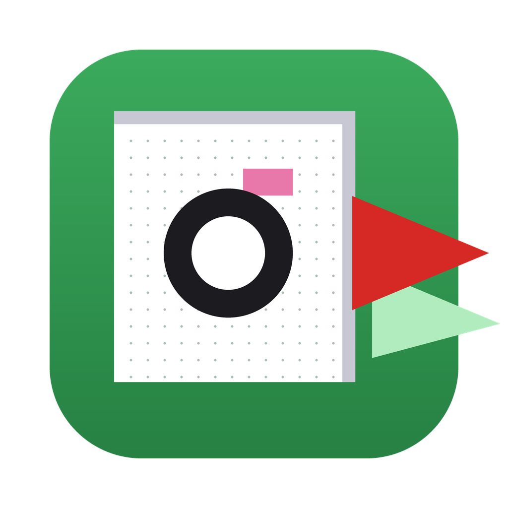

<p align="center">&nbsp;&nbsp;&nbsp;&nbsp;</p>

# poppsphere bundle

Three instruments and effects in one download, for **macOS, Windows and Linux**, each with a PDF manual.

| | what it is | formats |
|---|---|---|
| **[openprocess](openprocess/)** | a loop workspace after Oval's *ovalprocess*: an 8 × 8 browser of loops, a play area (left/right, loud/soft), effects, presets, snapshots and a timeline up to **30 minutes** that zooms, cutting or **gliding smoothly** between scenes | instrument and effect (**openprocess fx**): VST3 · VST2 · AU · LV2; app |
| **[openfield](openprocess/README.md#openfield)** | openprocess as an **Ambisonics encoder**: the play area is the sphere around you, a plan view sets distance, sounds orbit, swing, rise and drift, the live input can be placed in the space; ACN/SN3D 1st–7th order (up to 64 channels), AmbiX renders | instrument and effect (**openfield fx**): VST3 · VST2 · AU · LV2; app |
| **[Quell](quell/)** | a dynamic resonance suppressor: hundreds of tiny compressors across the spectrum, cutting peaks only while they ring | VST3 · VST2 · AU · LV2 · app |

Manuals: [openprocess](openprocess/docs/manual/openprocess%20Manual.pdf) ·
[openfield](openprocess/docs/manual-field/openfield%20Manual.pdf) ·
[Quell](quell/docs/manual/manual.pdf) (also inside every download).

## Download and install

Get the zip for your system from **[Releases](https://github.com/femifleming/poppsphere-bundle/releases/latest)**:
`poppsphere-bundle-macOS.zip`, `poppsphere-bundle-Windows.zip` or `poppsphere-bundle-Linux.tar.gz`.
Each holds one folder per product, with its manual.

| system | VST3 | other formats | app |
|---|---|---|---|
| macOS | `~/Library/Audio/Plug-Ins/VST3` | `.component` → `~/Library/Audio/Plug-Ins/Components`, `.vst` → `~/Library/Audio/Plug-Ins/VST` | `.app` → `/Applications` |
| Windows | `C:\Program Files\Common Files\VST3` | `.dll` (VST2) → your VST folder | `.exe` |
| Linux | `~/.vst3` | `.lv2` → `~/.lv2`, `.so` (VST2) → `~/.vst` | run the binary (ALSA or JACK) |

On a Mac, Homebrew installs them in one line each (first `brew tap femifleming/tap`):

```
brew install --cask openprocess openfield quell
```

The macOS builds are universal (Apple silicon + Intel) and signed ad hoc, not notarised: the Homebrew casks clear the
quarantine flag; if you install by hand, right-click the app → Open the first time, or run
`xattr -dr com.apple.quarantine <file>`.

## In a DAW

All three are plug-ins first; the apps are the same thing with their own window.

- **openprocess** and **openfield** each come twice. The plain one is an **instrument**: it goes on an instrument / MIDI
  track and plays by itself. **openprocess fx** and **openfield fx** are the same workspace as an **effect**: they go on an
  audio track (or after an instrument) and work on what comes in — openprocess fx lets the track through and can capture
  and chop it, openfield fx is an Ambisonics encoder for the track, which starts out placed straight ahead.
- **The host's transport** can run the timeline: the **flag | host** switch at the bottom left. With *host* the piece
  starts and stops with the DAW, at the DAW's position, also in an export.
- **Automation**: Master, Timeline Play, Follow Host, Recall Snapshot and, for each of the 24 sounds of the play area, its
  place, level and loop part ("Sound 01 Pan", "Sound 01 Level", …; in openfield Around, Height, Distance). Dragging a sound
  moves its parameters, so a host can record it.
- **Sessions** keep everything: play area, reels, timeline, loaded sounds, parameters and the size of the window.
- **Quell** is an effect; it only takes stereo outside VST3, so no host can fold a stereo track to mono through it.

**Ableton Live**: Browser → *Plug-Ins* → *VST3* (or *VST*, *Audio Units*) → *FreakiePie*. Drag **openprocess** or
**openfield** onto a MIDI track, **openprocess fx**, **openfield fx** or **Quell** onto any track. Live's tracks are stereo,
so openfield plays its stereo preview there; *render to file* in the plug-in still writes the full Ambisonic file.
After installing a new version: *Settings → Plug-Ins → Rescan*.

**REAPER**: any track takes either kind. For openfield give the track 16 channels (3rd order) or more, then insert it and
put a decoder after it. The manuals have a chapter on all of this.

## Build from source

```
git clone --recursive https://github.com/femifleming/poppsphere-bundle
cd poppsphere-bundle
cmake -B build -G Ninja -DCMAKE_BUILD_TYPE=Release        # macOS universal: add -DCMAKE_OSX_ARCHITECTURES="arm64;x86_64"
cmake --build build --target openprocess_All openfield_All openprocess_fx_All openfield_fx_All Quell_All
```

Tests: `openprocessTest`, `openfieldTest`, `QuellTest` (same build). Linux needs the usual JUCE packages
(see `.github/workflows/build.yml`). Every push builds and tests all three on all three systems; a `v*` tag publishes
a release.

## Licence

AGPL-3.0 (JUCE). VST2 support uses the GPL-3.0 FST headers in `third_party/vst2-fst`. VST is a trademark of
Steinberg Media Technologies GmbH. openprocess is an independent homage to ovalprocess, not made or endorsed by
Markus Popp / Oval. Quell is not affiliated with oeksound.
